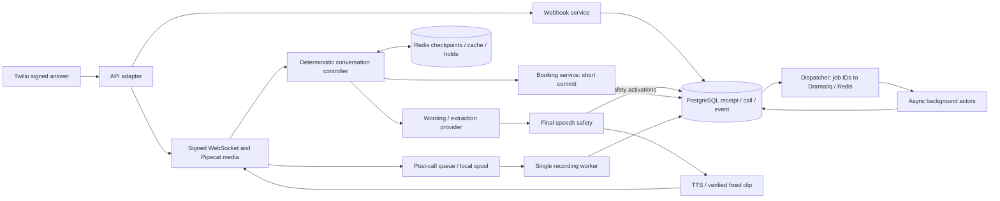

# Architecture and module ownership

**Present:** layered Python modular monolith with Twilio/Pipecat cloud media, Redis, PostgreSQL/Alembic, atomic answer acceptance, durable Dramatiq job processing and an enforced domain dependency rule. **Target:** Claude LLM with validated local speech/embeddings, governed retrieval and production access/telemetry/deployment controls.

The production controller uses a call-scoped booking service/calendar: PostgreSQL owns availability/commit and Redis holds only coordinate a short decision window. A committed appointment identity gates confirmed speech; reconnect consults PostgreSQL. The static/read-only calendar remains an explicit offline baseline. [Level 3](levels/level-03.md) owns policy/evidence; local speech providers and RAG remain future additions.

## Dependencies

| Layer | Responsibility / source |
|---|---|
| Composition | `roma/main.py` wires settings, database, services, media and routes |
| API | `roma/api/v1/` owns versioned `/api/v1` resources and shared envelopes while legacy compatibility routes continue to coexist |
| Services | Call, webhook, post-call and dispatcher use cases |
| Domain | Conversation, appointment time resolution, safety, cost and persistence contracts |
| Repositories | PostgreSQL units of work/records and Redis transient adapters |
| Providers | Twilio, calendar and Dramatiq SDK boundaries; provider contracts exist since L1 section 7; the Claude LLM adapter belongs to L2 and local speech adapters to L4–5 |
| Realtime | Pipecat processors, endpointing, streaming/cancellation, recorder and safe speech |
| Workers | Recording finalization and database-authoritative background effects |

Dependencies point inward toward domain rules. Do not move SDKs, FastAPI or SQL into the conversation policy merely to connect a feature. Retain the existing layered `roma/` package.

The [backend architecture contract](22-backend-architecture-contract.md) maps the roadmap's `backend/app` example to current packages and records the enforceable section 6 rules. The package rename itself is rejected as churn; boundary enforcement and module ownership are the useful work.

## Transaction boundaries

`/answer` commits receipt/call/event before successful TwiML; failure is 503. Post-call handling commits call/job intents before recording-queue ack. Background actors commit their effect and settlement together. The booking service now reuses slot locking/active-slot uniqueness through production controller and API paths, with cancellation/reuse and same-SID appointment reconciliation.

A short booking transaction can run in the turn; inference, audio, external sync and recording conversion cannot hold it open. PostgreSQL sessions are short-lived and process pool totals must remain within the database budget.

## Relational foundations

The [schema catalog](20-relational-schema.md) owns the physical table/key/constraint/index and retention rationale. L1 section 4 adds checkpoint and model/benchmark evidence models; these tables are not yet live pipeline consumers. The additive migration preserves old keys/semantics and adds optional turn-language metadata. L1 section 5 adds the [migration workflow](21-database-migrations.md) and separate opt-in demo seeds; migration/seeding tools depend only on database settings and never initialize voice providers.

L1 section 6 moves shared private-file primitives into `roma.core.private_files` and keeps concrete Redis checkpoint adapters out of the domain package export. A focused architecture test now prevents `roma/domain/**` from importing API, provider, repository, realtime, worker or SDK modules. L1 section 7 adds provider contracts for STT, LLM, TTS, embeddings and telephony; Claude replaces the historical OpenAI LLM seam, while Sarvam speech adapters are retained until measured local ASR/TTS replacements are ready.

## Deployment and target

Keep Twilio and the existing Pipecat comparison profile. Direct local ASR/TTS inference precedes speech model serving; embeddings/pgvector arrive with conditional RAG at L9. Claude Haiku 5.5 is the main wording/extraction LLM behind its provider interface. No OpenAI calls or fallback are allowed. The target permits Claude as its only external GenAI API, alongside carrier/internal services.

Existing Compose is pre-v4 infrastructure tooling, not proof of Level 13. No production host/GPU/SLO is established by these docs. Replica growth requires measured capacity, shared coordination and route/auth checks; recording startup recovery currently supports one recording consumer. See [state](06-state-and-cache.md), [concurrency](08-concurrency.md) and [decisions](decisions.md).

## Section 12 safety audit boundary

The domain filter creates PII-minimized rule activations; `SafetyService` bounds persistence and chooses the fail-safe; `PostgresSafetyEventStore` writes existing call/turn/event relations. `roma/main.py` injects this into the existing pre-TTS processor, and the text orchestrator accepts the same service. REST routes call short-session query methods for event lists, grouped counts and call-specific events. No new schema, model download or provider change is involved. See [the safety contract](04-guardrails.md).

## Section 14 audio ownership

The dependency-free `roma/domain/audio` package owns the codec, strict PCM/framing, reference streaming resampler and fixed jitter primitives. `roma/eval/audio.py` drives a deterministic offline lab. The Twilio adapter validates media before native decoding and exposes per-stream sequence/alignment counters; production composition retains existing cloud rates and native control/output behavior. Local ASR/TTS consumption and adaptive buffering/PLC remain later gated work. See [audio contract](05-endpointing-vad.md#section-14-reusable-audio-contract).

## Sections 15–17 speech ownership

The domain owns endpoint decisions and caller-language evidence. Silero and STT SDKs stay in providers; `SpeechInputService` owns bounded framing/orchestration and returns finalized text to the existing controller. `CallState` saves a backward-compatible router object in existing checkpoints. No provider/model chooses a stage or reply policy. The HF speech endpoint is an owner-permitted opt-in lab exception to the self-hosted target, with no automatic deployment/downloads. Production carrier rates/providers remain until measured later integration. See [Level 4](levels/level-04.md#sections-1517-design-and-acceptance).

Sections 18–19 add isolated evaluation/synthesis paths: evaluation code measures public speech and hands completed evidence to `PostgresBenchmarkStore`; it never holds SQL sessions across inference. `SpeechSynthesisService` orchestrates deterministic normalization, SafetyService, cache and `TTSProvider`; the adapter owns local runtime/artifact details. Production telephony composition stays unchanged until later integration gates. See [Level 4](levels/level-04.md) and [Level 5](levels/level-05.md).

Section 20's local lab is an isolated application composition: `VoicePrototype` joins existing speech input, text/booking, safety and TTS services; `LocalAudioDevice` owns optional PortAudio transport, and `PostgresVoiceLabStore` owns short turn/event transactions. The CLI refuses hosted ASR in local mode; mocks are default. Production telephony is unchanged. [Level 6](levels/level-06.md) separates implemented integration from the pending actual microphone/native gate.

## Owner-selected local Turbo boundary

The isolated local prototype/WAV benchmark now use one optional `WhisperMLXSTT` behind `STTProvider` and `LocalLanguageSTT`; the adapter imports MLX lazily after verifying a pinned local snapshot. All language states share that model and exact text-boundary normalization, with no cascade. Indic weights are removed; existing TTS and production telephony remain intact. This is a development selection, not a production rollout: [Level 4](levels/level-04.md#whisper-turbo-replacement--2026-10-21) records failed mixed/native recognition gates.
